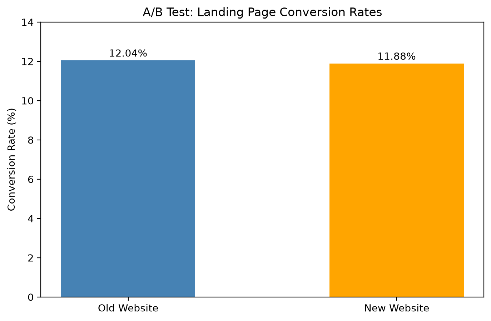

# A/B Testing: Landing Page Conversion Analysis

## Objective
Investigate whether an updated landing page produces a different conversion rate from the original page using a historical e-commerce A/B testing dataset.

## Dataset
Udacity A/B testing educational dataset (~294,478 records), mirrored on [Kaggle](https://www.kaggle.com/datasets/zhangluyuan/ab-testing). Columns: `user_id`, `timestamp`, `group`, `landing_page`, and `converted`. The notebook fetches a public GitHub-hosted CSV; if it fails, download the CSV manually from Kaggle.

## Tools
Python, Pandas, NumPy, Matplotlib, Statsmodels, Visual Studio Code, Jupyter Notebook, and GitHub.

## Method
1. Inspect rows, columns, missing values, and group/page inconsistencies.
2. Identify duplicate users and mismatched group/page records.
3. For the secondary matched-page analysis, remove group/page mismatches and retain one row per user. This is not an intention-to-treat analysis.
4. For the primary assignment-based analysis, retain each user's earliest recorded observation and compare users according to their assigned group.
5. Compute and visualize conversion rates.
6. Run a two-sided two-proportion Z-test and calculate a 95% Newcombe confidence interval for the difference.
7. Assess statistical and practical significance, discuss limitations, and develop a business recommendation.

## Conversion Rate Visualization

## Results

**Primary assignment-based analysis: 290,584 unique users**

- **Control conversion rate:** 12.0418%
- **Treatment conversion rate:** 11.8831%
- **Difference (treatment minus control):** -0.1587 percentage points
- **Z-statistic:** -1.3177
- **Two-sided p-value:** 0.187589
- **95% confidence interval:** [-0.3947, +0.0773] percentage points
- **Recommendation:** Do not implement the redesigned landing page solely to improve conversions based on the current experimental evidence.

### Statistical Interpretation

The original landing page achieved a slightly higher observed conversion rate (12.0418%) compared with the redesigned landing page (11.8831%).

The two-sided Z-test produced a p-value of 0.187589, which is greater than the significance threshold of 0.05. Therefore, we failed to reject the null hypothesis.

The 95% confidence interval includes zero, indicating that the analysis did not establish a statistically significant difference between the conversion rates.

Although the original landing page performed slightly better in the observed data, there is insufficient statistical evidence to conclude that the redesigned landing page is truly better or worse.

### Business Conclusion

The experiment does not provide sufficient statistical evidence that the redesigned landing page improves user conversion rates.

Therefore, the company should not replace the original landing page solely to increase conversions based on these findings.

Additional testing and consideration of business metrics, including implementation costs, revenue per conversion, and the minimum practically important improvement, may help guide future decisions.

## Important Limitations

This is a historical educational dataset. Group/page mismatches and duplicate user IDs complicate causal inference.

The primary analysis retains each user's earliest recorded observation and compares users according to their assigned experiment groups. The secondary matched-page analysis excludes inconsistent group/page records and may introduce selection bias.

Randomization quality, original experimental procedures, and independence assumptions have not been independently verified. These findings should not be treated as a real-world deployment recommendation without additional validation.

## How to Run

1. Download or clone this GitHub repository.
2. Open `ab_testing_analysis.ipynb` in Visual Studio Code or Jupyter Notebook.
3. Install the required dependencies using `pip install -r requirements.txt`.
4. Select the appropriate Python environment.
5. Run the notebook cells from top to bottom.

The notebook retrieves a publicly hosted CSV dataset. If the URL is unavailable, download `ab_data.csv` from Kaggle and update the dataset path.

## Future Improvements

- Conduct pre-experiment statistical power analysis.
- Perform sample-ratio mismatch checks.
- Investigate conversion-rate trends over time.
- Examine the causes of group/page mismatches.
- Establish a minimum detectable effect and a preregistered decision threshold.
- Explore additional business metrics and customer segments.
